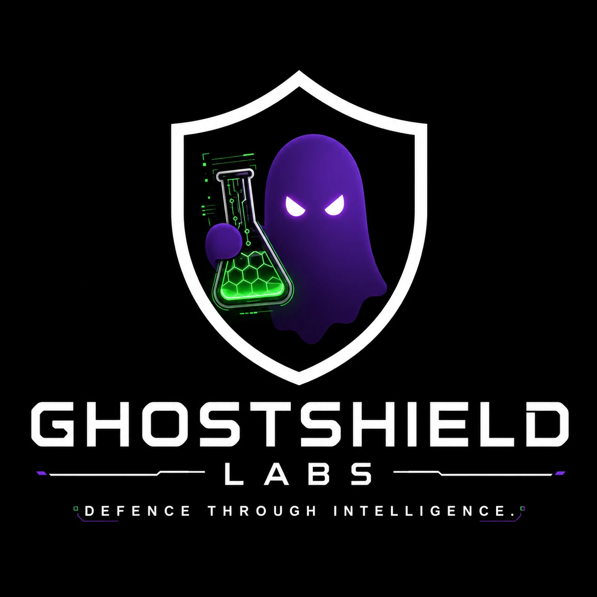

  

<h1 align="center">GHOSTSHIELD LABS</h1>

<b>Defence Through Intelligence.</b>

---

### Projects

| | Repo | What it does |
|---|---|---|
| **PHP2SHELL** | [PHP2SHELL-POC](https://github.com/joser14/PHP2SHELL-POC) | Exploit chain for CVE-2026-109618 / CVE-2026-109619. UAF via `session.upload_progress` for reliable worker kills, pivots to session poisoning + LFI for RCE. Web UI with live streaming. |
| **OrchestraAI** | [OrchestraAI](https://github.com/joser14/OrchestraAI) | Local AI agent platform. Composer breaks down tasks, workers execute, results land as files and PDFs. Runs on Ollama + OpenClaw, fits on a 4GB laptop or scales with a GPU. Windows, Mac, Linux. |
| **MalLab** | [MalLab](https://github.com/joser14/MalLab) | Malware analysis lab for Windows. Static triage, YARA scanning, threat-intel lookups, sandbox detonation. One installer, nothing runs on your host. |
